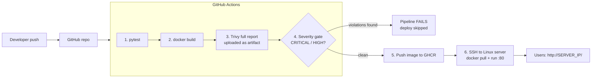

# Automated Container Vulnerability Scanner (Problem 21)

DevOps Hackathon 2026 (Dev Sprint'26) - BIT DevOps Community.

A GitHub Actions pipeline that **builds a container image, scans it with Trivy, and blocks
deployment if the image contains vulnerabilities at or above a configured severity**.
Images that pass are pushed to GitHub Container Registry (GHCR) and deployed to a Linux server over SSH.

## Architecture



> **First time here?** Follow [docs/STEP_BY_STEP.md](docs/STEP_BY_STEP.md) - it walks through GitHub, server setup, secrets and the demo in order.

## Repository layout

| Path | Purpose |
|------|---------|
| `app/` | Small Flask app (`/` and `/health`) + pytest tests |
| `Dockerfile` | **Secure** image (python 3.12 alpine, non-root) - should pass |
| `Dockerfile.vulnerable` | **Intentionally vulnerable** image (python 3.8 + old packages) - should fail |
| `BUILD_TARGET` | One-line file selecting which Dockerfile the pipeline builds |
| `.github/workflows/security-gate.yml` | The pipeline (test -> scan -> gate -> deploy) |
| `SECURITY_POLICY.md`, `trivy.yaml`, `.trivyignore` | Severity policy |
| `scripts/scan-local.sh` | Run the same scan/gate locally |
| `docs/SRS.md` | Software Requirements Specification |

## How the gate works

1. Trivy generates a **full report** (all severities) as table + JSON and uploads it as a build artifact - this always runs, so evidence exists even for failing builds.
2. A second Trivy step runs with `severity: CRITICAL,HIGH`, `ignore-unfixed: true`, `exit-code: 1`. Any matching finding makes the job fail.
3. The `deploy` job has `needs: scan`, so a failed gate means it never runs.

Policy details: see [SECURITY_POLICY.md](SECURITY_POLICY.md).

## One-time setup

1. Create a GitHub repo and push this project to the `main` branch.
2. Prepare a Linux server (Ubuntu VM, ports 22 and 80 open) with Docker installed:
   ```bash
   curl -fsSL https://get.docker.com | sudo sh
   sudo usermod -aG docker $USER
   ```
3. Create an SSH key pair for deployment and add the public key to the server's `~/.ssh/authorized_keys`.
4. In the repo go to **Settings -> Secrets and variables -> Actions** and add:
   - `SERVER_HOST` - server public IP
   - `SERVER_USER` - SSH username (e.g. `ubuntu`)
   - `SERVER_SSH_KEY` - the **private** key
5. Make sure Actions has write access to packages: **Settings -> Actions -> General -> Workflow permissions -> Read and write**.

If `SERVER_HOST` is not set the pipeline still builds, scans and pushes to GHCR, and prints a warning instead of deploying.

## Demo script (final demonstration)

**A. Failing scan (policy-triggered failure)**
```bash
echo "Dockerfile.vulnerable" > BUILD_TARGET
git add BUILD_TARGET && git commit -m "demo: build vulnerable image" && git push
```
Open the Actions run: `scan` goes red with a CVE table, `deploy` is skipped. Download the `trivy-reports-*` artifact.

**B. Updated image passes**
```bash
echo "Dockerfile" > BUILD_TARGET
git add BUILD_TARGET && git commit -m "demo: build patched image" && git push
```
`scan` goes green, `deploy` runs, and `http://<SERVER_IP>/` shows the page with `Image variant: secure`.

## Run locally

```bash
# app only
pip install -r app/requirements.txt pytest && python -m pytest app -v
python app/app.py                       # http://localhost:5000

# scan + gate (needs docker and trivy installed)
./scripts/scan-local.sh Dockerfile.vulnerable   # expect: GATE FAILED
./scripts/scan-local.sh Dockerfile              # expect: GATE PASSED
```

## Evidence to collect (put in `evidence/`)

- Screenshot: failed run (red `scan`, skipped `deploy`)
- Screenshot: passing run (green `scan` and `deploy`)
- `trivy-report.txt` / `.json` from both runs
- Screenshot of the live page and `curl http://<SERVER_IP>/health`

## Limitations

- The scanner reports only vulnerabilities known to Trivy's database at scan time; results change as the database updates.
- Only OS packages and Python libraries are scanned (`scanners: vuln`); secrets and misconfiguration scanning are not enabled.
- Single-server deployment, no rollback or blue/green switching.
- The "vulnerable" image exists only for the demo and must never be deployed outside the demo.
